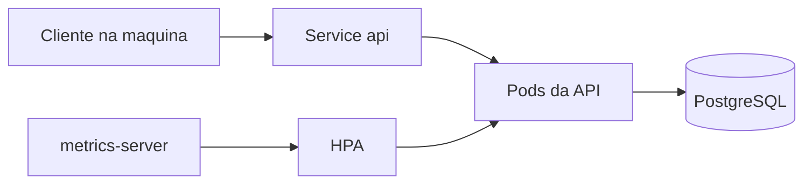

# Delivery Lab no Kubernetes

O mesmo container do [Delivery Lab](https://github.com/almeidasantosdev/delivery-lab), agora num cluster local. A API recebe um webhook de pagamento ficticio, grava o evento uma unica vez e o worker reentrega com espera crescente. Cada replica faz as duas coisas. O `FOR UPDATE SKIP LOCKED` impede que dois pods peguem o mesmo job.

Este repositorio e so a orquestracao. A imagem, o Terraform, o Prometheus e o Grafana continuam no outro repositorio. A imagem nao e publicada: o Kind carrega `delivery-lab:local` direto na maquina.

Os dados sao ficticios. A senha `delivery` existe apenas dentro do cluster local.

## Tecnologias

| Parte | Ferramenta |
| --- | --- |
| Imagem | A mesma do Delivery Lab, tag local `delivery-lab:local` |
| Cluster | Kind ou k3s |
| Carga | Deployment, Service NodePort, probes em `/health` |
| Escala | HorizontalPodAutoscaler de 1 a 3 replicas, CPU a 70% |
| Banco | PostgreSQL 16 no proprio cluster |
| Metrica do HPA | metrics-server v0.9.1 |
| Checagem | kubeconform no GitHub Actions |

A decisao de manter os manifestos separados esta em `docs/adr/001-repositorio-separado.md`.

## Arquitetura



O Service publica a porta 3000 do pod na porta 30080 do no. No Kind, essa porta do no aparece em `localhost:3000`. O `/health` consulta o Postgres. Enquanto o banco nao responde, o pod nao fica pronto. O HPA le a CPU pelo metrics-server e mexe so no Deployment da API.

## Como utilizar

### Pre-requisitos

- Docker
- Kind 0.33 ou outro Kind com Kubernetes 1.34 ou mais novo, porque o metrics-server v0.9.1 exige essa faixa
- kubectl
- O codigo do Delivery Lab, para construir a imagem

```powershell
git clone https://github.com/almeidasantosdev/delivery-lab.git
git clone https://github.com/almeidasantosdev/delivery-lab-k8s.git
```

As duas pastas ficam lado a lado. Se o Delivery Lab estiver em outro caminho, defina `DELIVERY_LAB` antes de subir.

### Subir no Kind

Na pasta `delivery-lab-k8s`:

```powershell
powershell -ExecutionPolicy Bypass -File .\scripts\up.ps1
```

O script faz esta sequencia:

```powershell
docker build -t delivery-lab:local -f ..\delivery-lab\docker\Dockerfile ..\delivery-lab
kind create cluster --config .\kind\cluster.yaml
kind load docker-image delivery-lab:local --name delivery
kubectl apply -k .\k8s
kubectl apply -f .\kind\metrics-server.yaml
kubectl -n delivery rollout status deploy/api
```

`kind/metrics-server.yaml` e o manifesto v0.9.1 com `--kubelet-insecure-tls`. Sem esse argumento o Kind nao entrega CPU ao HPA. Confira:

```powershell
kubectl -n delivery get pods,svc,hpa
Invoke-RestMethod http://localhost:3000/health
```

| Recurso | Nome | Funcao |
| --- | --- | --- |
| Deployment | `api` | Roda `delivery-lab:local`. Probes de inicio, prontidao e vida em `GET /health` |
| Service | `api` | NodePort 30080, mapeado pelo Kind para a porta 3000 do host |
| HorizontalPodAutoscaler | `api` | Entre 1 e 3 pods quando a CPU media passa de 70% do pedido de 100m |
| Deployment | `postgres` | PostgreSQL 16 para o `/health` e para a fila |
| Secret | `database` | Usuario, senha e `DATABASE_URL` do laboratorio local |

O alvo do HPA aparece em `kubectl -n delivery get hpa` depois que o metrics-server fica pronto. Abaixo de 70% o minimo continua em 1 pod. Acima disso, o teto e 3. Cada pod novo tambem roda o worker.

Para remover o cluster:

```powershell
kind delete cluster --name delivery
```

### k3s

O mesmo `kubectl apply -k k8s` vale no k3s. A imagem local precisa entrar no containerd do k3s, e o metrics-server do Kind nao deve ser usado, porque o argumento `--kubelet-insecure-tls` e especifico do Kind.

```sh
docker build -t delivery-lab:local -f ../delivery-lab/docker/Dockerfile ../delivery-lab
docker save delivery-lab:local | sudo k3s ctr images import -
kubectl apply -k k8s
kubectl apply -f https://github.com/kubernetes-sigs/metrics-server/releases/download/v0.9.1/components.yaml
kubectl -n delivery port-forward svc/api 3000:3000
```

Se `kubectl top nodes` ja responder, o cluster tem metrics-server e o segundo `kubectl apply` pode ficar de fora. Kubernetes anterior a 1.34 usa o metrics-server v0.8.x.

### OpenShift

`oc apply -k k8s` cria os mesmos Deployment, Service, probes e HPA. O container da API ja entra como usuario nao root e o pod descarta capabilities. A publicacao para fora do cluster, neste laboratorio, nao vem no manifesto:

```sh
oc expose svc/api
```

O Postgres fixa o uid 70, que e o usuario da imagem `postgres:16-alpine`, para conseguir escrever no volume. Num projeto com a politica restricted, esse uid pode ser recusado. Nesse caso o volume do Postgres precisa de um uid dentro da faixa do projeto.

## O que cada arquivo faz

```text
kind/cluster.yaml          cluster local e a porta 3000 do host
kind/metrics-server.yaml   metrics-server v0.9.1 ajustado para o Kind
k8s/api.yaml               Deployment e Service da API
k8s/hpa.yaml               HorizontalPodAutoscaler
k8s/database.yaml          Secret, volume e PostgreSQL
k8s/kustomization.yaml     junta os manifestos no namespace delivery
scripts/up.ps1             sobe tudo no Kind, no Windows
scripts/up.sh              a mesma sequencia no shell
```
