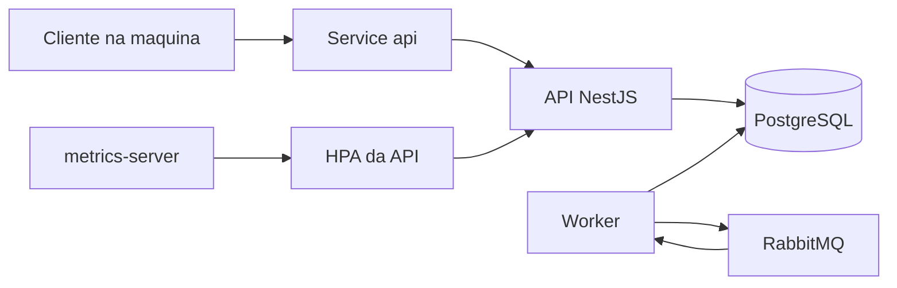

# Delivery Lab no Kubernetes

Cluster local da imagem do [Delivery Lab](https://github.com/almeidasantosdev/delivery-lab). A aplicacao recebe um webhook de pagamento ficticio, grava o evento e uma linha de outbox no Postgres, e um processo separado publica e consome o RabbitMQ. Este repositorio so descreve essa carga. A imagem, o Terraform, o Prometheus e o Grafana continuam no outro repositorio.

A imagem nao e publicada. O Kind carrega a tag `delivery-lab:local`, construida na maquina a partir de `docker/Dockerfile`.

Os dados sao ficticios. A senha `delivery` existe apenas neste laboratorio.

## Tecnologias

| Parte | Ferramenta |
| --- | --- |
| Imagem | A do Delivery Lab, tag local `delivery-lab:local` |
| API | `node dist/main.js`, porta 3000, `GET /health` consulta o Postgres |
| Worker | `node dist/worker-main.js`, `GET /health` na porta 3001 |
| Fila | RabbitMQ `3.13-alpine`. O worker declara `delivery.jobs`, as filas de retry e `delivery.jobs.dlq` |
| Banco | PostgreSQL 16. O schema entra no startup da API e do worker |
| Chart | Helm, em `charts/delivery-lab` |
| Cluster | Kind 0.33, no Kubernetes 1.34, ou k3s |
| Escala | HorizontalPodAutoscaler da API, de 1 a 3 replicas, CPU a 70% |
| Metrica do HPA | metrics-server v0.9.1, fora do chart |

A decisao de manter o cluster em outro repositorio esta em `docs/adr/001-repositorio-separado.md`.

## Arquitetura



A API nao fala com o RabbitMQ. Ela grava o outbox na mesma transacao do webhook. O worker le esse outbox com `FOR UPDATE SKIP LOCKED`, publica em `delivery.jobs` e consome a fila. Se o provedor simulado falha, a mensagem espera numa fila de retry. Na quinta falha ela vai para `delivery.jobs.dlq`. O contrato HTTP esta no README do Delivery Lab.

O Service `api` publica a porta 3000 do pod na porta 30080 do no. No Kind, essa porta aparece em `localhost:3000`. Enquanto o Postgres nao responde, a API nao fica pronta. O `/health` do worker tambem consulta o RabbitMQ, na porta definida por `WORKER_HEALTH_PORT`.

O chart sobe uma replica de Postgres e uma de RabbitMQ. Nao ha replicacao dos dois. O volume some junto com o cluster Kind.

O HPA le a CPU da API pelo metrics-server. Ele nao mexe no worker. Com `api.hpa.enabled`, o campo `api.replicas` fica de fora do Deployment, para um `helm upgrade` nao desfazer a escala. Na primeira instalacao o Deployment nasce com uma replica e o minimo do HPA e 1.

`GET /metrics` existe na API e no worker. Este chart nao instala Prometheus nem Grafana.

## Por que o chart substituiu os manifestos

Antes, `k8s/` era um kustomize de um container so, com a API e o worker no mesmo processo. A aplicacao agora tem dois comandos e um broker. Manter esse diretorio ao lado do chart criaria duas copias da mesma carga. O chart e a unica descricao da aplicacao. `kind/cluster.yaml` e `kind/metrics-server.yaml` continuam soltos, porque o cluster e o coletor de CPU nao entram na release.

Quem nao quiser gravar a release no cluster pode gerar os manifestos e aplica-los:

```powershell
helm template delivery .\charts\delivery-lab --namespace delivery | kubectl apply -f -
```

## Como utilizar

### Pre-requisitos

- Docker
- Helm 3
- kubectl
- Kind 0.33, com a imagem de no deste repositorio (Kubernetes 1.34). O metrics-server v0.9.1 pede essa faixa
- O codigo do Delivery Lab, para construir a imagem

```powershell
git clone https://github.com/almeidasantosdev/delivery-lab.git
git clone https://github.com/almeidasantosdev/delivery-lab-k8s.git
```

As duas pastas ficam lado a lado. Se o Delivery Lab estiver em outro caminho, defina `DELIVERY_LAB` antes de subir.

### Subir no Kind

Na pasta `delivery-lab-k8s`:

```powershell
powershell -ExecutionPolicy Bypass -File .\scripts\up.ps1
```

No shell, `./scripts/up.sh` faz a mesma sequencia. O script exige `docker`, `kind`, `kubectl` e `helm`.

```powershell
docker build -t delivery-lab:local -f ..\delivery-lab\docker\Dockerfile ..\delivery-lab
kind create cluster --config .\kind\cluster.yaml
kind load docker-image delivery-lab:local --name delivery
helm upgrade --install delivery .\charts\delivery-lab --namespace delivery --create-namespace --wait --timeout 10m
kubectl apply -f .\kind\metrics-server.yaml
```

`kind/cluster.yaml` fixa o no `kindest/node:v1.34.11` publicado com o Kind 0.33.0 e mapeia a porta 30080 do no para a porta 3000 da maquina. `kind/metrics-server.yaml` e o manifesto v0.9.1 com `--kubelet-insecure-tls`. Sem esse argumento o Kind nao entrega CPU ao HPA.

```powershell
kubectl -n delivery get pods,svc,hpa
Invoke-RestMethod http://localhost:3000/health
kubectl -n delivery port-forward svc/worker 3001:3001
```

O alvo do HPA aparece em `kubectl -n delivery get hpa` depois que o metrics-server fica pronto. Abaixo de 70% da CPU pedida (100m) o minimo continua em 1 pod da API. Acima disso, o teto e 3.

Para remover o cluster:

```powershell
kind delete cluster --name delivery
```

`helm uninstall delivery --namespace delivery` tira a release e deixa o cluster.

### Helm

Os nomes `api`, `worker`, `postgres` e `rabbitmq` sao fixos. Use uma release por namespace. Os exemplos usam a release `delivery` e o namespace `delivery`.

```powershell
helm lint .\charts\delivery-lab
helm template delivery .\charts\delivery-lab --namespace delivery
helm upgrade --install delivery .\charts\delivery-lab --namespace delivery --create-namespace --wait --timeout 10m
```

Valores principais, em `charts/delivery-lab/values.yaml`:

| Valor | Padrao neste laboratorio | Efeito |
| --- | --- | --- |
| `image.repository` / `image.tag` | `delivery-lab` / `local` | Imagem da API e do worker |
| `image.pullPolicy` | `IfNotPresent` | O Kind usa a imagem carregada na maquina |
| `api.enabled` | `true` | Liga o Deployment e o Service da API |
| `api.replicas` | `1` | Vale quando `api.hpa.enabled` esta desligado |
| `api.resources` | 100m/128Mi pedidos, 500m/512Mi de limite | CPU e memoria da API |
| `api.port` | `3000` | `PORT` e a porta do probe |
| `api.hpa.*` | 1 a 3, CPU 70% | HPA somente da API |
| `worker.enabled` | `true` | Liga o Deployment e o Service do worker |
| `worker.replicas` | `1` | Numero de workers |
| `worker.healthPort` | `3001` | `WORKER_HEALTH_PORT` e a porta do probe |
| `worker.intervalMs` | `2000` | `WORKER_INTERVAL_MS` |
| `worker.backoffBaseMs` | `1000` | `BACKOFF_BASE_MS` |
| `worker.resources` | 100m/128Mi pedidos, 500m/512Mi de limite | CPU e memoria do worker |
| `api.extraEnv` / `worker.extraEnv` | vazio | Pares `name` e `value` alem das variaveis acima |
| `postgres.*` | usuario, senha e banco `delivery` | Secret `database` e `DATABASE_URL` |
| `rabbitmq.*` | usuario e senha `delivery` | Secret `rabbitmq` e `RABBITMQ_URL` |

`worker.enabled` exige `rabbitmq.enabled`. A API e o worker exigem `postgres.enabled`. O chart recusa a combinacao invalida no `helm template`.

Com o worker desligado, a API ainda grava o webhook e o outbox. Ninguem publica essa linha. Com a API desligada, o worker continua no ar, mas nao recebe webhook novo.

Exemplo que sobe so a API e o Postgres, sem fila:

```powershell
helm template delivery .\charts\delivery-lab --namespace delivery --set worker.enabled=false --set rabbitmq.enabled=false
```

### O que sobe

| Recurso | Nome | Funcao |
| --- | --- | --- |
| Deployment | `api` | `node dist/main.js`. Probes em `GET /health` |
| Service | `api` | NodePort 30080, mapeado pelo Kind para a porta 3000 do host |
| HorizontalPodAutoscaler | `api` | 1 a 3 pods da API, CPU media acima de 70% do pedido |
| Deployment | `worker` | `node dist/worker-main.js`. Probes em `GET /health` na porta 3001 |
| Service | `worker` | ClusterIP da porta 3001. Nao sai no host |
| StatefulSet | `rabbitmq` | Uma replica. O cliente usa o Service `rabbitmq` na porta 5672 |
| Service | `rabbitmq` | ClusterIP do AMQP. `RABBITMQ_URL` aponta para este nome |
| Service | `rabbitmq-headless` | Servico sem IP, exigido pelo StatefulSet |
| Deployment | `postgres` | PostgreSQL 16, estrategia Recreate por causa do volume |
| Service | `postgres` | ClusterIP 5432. `DATABASE_URL` aponta para este nome |
| Secret | `database` | Usuario, senha, banco e `DATABASE_URL` de exemplo |
| Secret | `rabbitmq` | Usuario, senha e `RABBITMQ_URL` de exemplo |

O worker espera a porta do Postgres e a do RabbitMQ antes de abrir o processo. A API espera so o Postgres. Os dois aplicam `sql/001_init.sql` ao subir. As filas nao tem manifesto: o worker as declara ao conectar.

O container do RabbitMQ usa o uid 100 e o gid 101, que sao os da imagem `rabbitmq:3.13-alpine`. O Postgres usa o uid 70, o da imagem `postgres:16-alpine`. A API e o worker usam o uid 1000, o do usuario `node` na imagem. O chart grava esse numero porque o Kubernetes recusa `runAsNonRoot` quando a imagem so diz o nome do usuario.

### Segredos de exemplo

`values.yaml` repete a senha do Compose: usuario `delivery`, senha `delivery`. O chart monta `DATABASE_URL` e `RABBITMQ_URL` a partir desses campos. A senha de exemplo nao tem caractere reservado de URL.

Para outro cluster, passe outro valor na hora da instalacao e nao grave a senha no Git:

```powershell
helm upgrade --install delivery .\charts\delivery-lab --namespace delivery --create-namespace --set postgres.password=troque --set rabbitmq.password=troque
```

### k3s

A imagem local precisa entrar no containerd do k3s. O metrics-server do Kind nao deve ser usado, porque `--kubelet-insecure-tls` e especifico do Kind.

```sh
docker build -t delivery-lab:local -f ../delivery-lab/docker/Dockerfile ../delivery-lab
docker save delivery-lab:local | sudo k3s ctr images import -
helm upgrade --install delivery ./charts/delivery-lab --namespace delivery --create-namespace --wait --timeout 10m
kubectl apply -f https://github.com/kubernetes-sigs/metrics-server/releases/download/v0.9.1/components.yaml
kubectl -n delivery port-forward svc/api 3000:3000
```

Se `kubectl top nodes` ja responder, o cluster tem metrics-server e o segundo `kubectl apply` pode ficar de fora. Kubernetes anterior a 1.34 usa o metrics-server v0.8.x. O k3s ja traz uma StorageClass local. O chart nao define outra.

### OpenShift

`helm upgrade --install` contra o projeto cria os mesmos recursos. A API ja entra como usuario nao root e o pod descarta capabilities. A publicacao para fora do cluster, neste laboratorio, nao vem no chart:

```sh
oc expose svc/api
```

Num projeto com a politica restricted, o uid 70 do Postgres, o uid 100 do RabbitMQ e o uid 1000 da aplicacao podem ser recusados. Nesse caso o volume precisa de um uid dentro da faixa do projeto, e os `runAsUser` do chart precisam acompanhar essa faixa.

## CI

O arquivo `.github/workflows/ci.yml` roda em pull request e no push da branch `main`.

1. `helm lint --strict`
2. `helm template` do chart inteiro e de um recorte sem API, worker e RabbitMQ
3. kubeconform 0.8.0, estrito, no Kubernetes 1.34.0
4. Kind 0.33.0 com o no definido em `kind/cluster.yaml`
5. Build de `delivery-lab:local` a partir de `almeidasantosdev/delivery-lab`, branch `main`, e `kind load`
6. `helm upgrade --install` com espera de ate 10 minutos
7. `GET http://127.0.0.1:3000/health`

Nao ha imagem publicada do Delivery Lab. O job constroi a imagem do outro repositorio. Se aquele `main` nao construir, este workflow falha junto. O metrics-server nao entra no job: o `/health` nao depende dele.

## O que cada arquivo faz

```text
charts/delivery-lab/     chart da API, do worker, do RabbitMQ e do Postgres
kind/cluster.yaml        cluster local, no 1.34 e a porta 3000 do host
kind/metrics-server.yaml metrics-server v0.9.1 ajustado para o Kind
scripts/up.ps1           sobe tudo no Kind, no Windows
scripts/up.sh            a mesma sequencia no shell
.github/workflows/ci.yml lint, kubeconform e smoke test no Kind
docs/adr/                decisao de manter o cluster neste repositorio
```

## Limites deste laboratorio

Postgres e RabbitMQ tem uma replica cada. O HPA so altera a API, e o metrics-server do Kind nao vale em outro cluster. A imagem construida aqui nao vai para um registry. As senhas do `values.yaml` sao as do Compose local.
